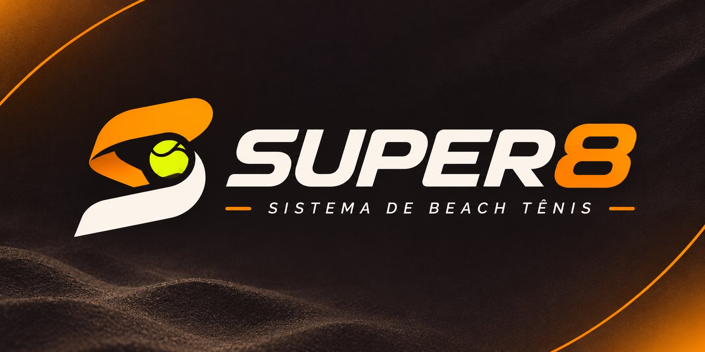
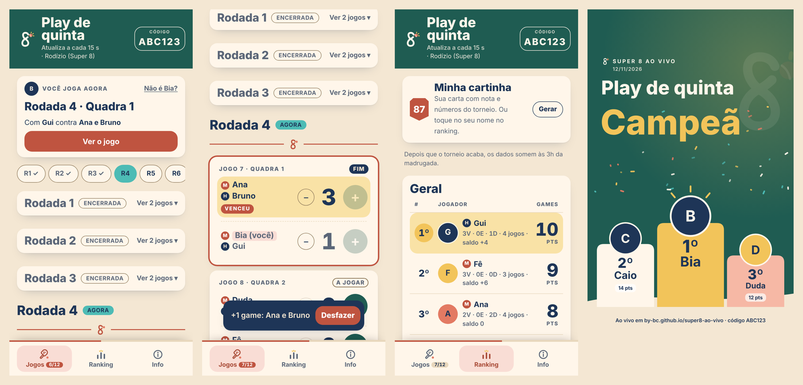
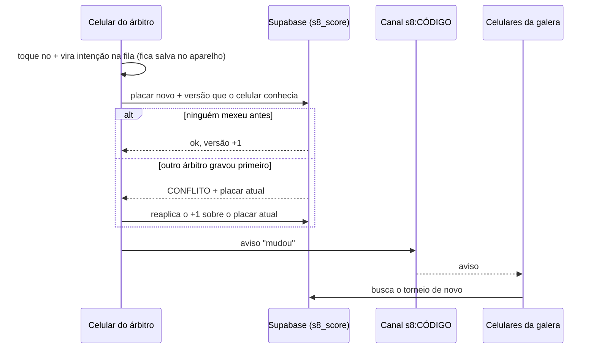

# Super 8 ao vivo 🎾

[](https://github.com/by-BC/super8-ao-vivo/actions/workflows/deploy.yml)
   

Sorteio, placar e ranking de torneios de beach tennis, **ao vivo no celular de todo mundo**.
Quem organiza cria o torneio e recebe um **código** (tipo `VD22NV`). Quem tem o código acompanha;
quem tem o **PIN de árbitro** lança placar. Sem login, sem instalar nada: o link vai no grupo do WhatsApp e pronto.

**No ar:** https://by-bc.github.io/super8-ao-vivo/



## Por que existe

Num play com rodízio, alguém precisa sortear as duplas, anotar placar de várias quadras e fazer a conta do ranking no fim.
O app faz isso no celular que todo mundo já tem na mão, com uma regra de ouro: **nada pode atrapalhar o jogo**
(sem cadastro, sem senha, funciona com internet ruim na quadra).

## Pensado pra celular, na quadra

- **Desfazer ponto:** cada game lançado mostra um aviso com *Desfazer* por alguns segundos. Dedo grosso na areia não estraga o placar.
- **Tela sempre acesa** pro árbitro e no modo telão (Wake Lock API), sem precisar desbloquear a cada ponto.
- **"Sou eu":** cada um escolhe o próprio nome e vê no topo o próximo jogo, a quadra, o parceiro e os adversários. Os jogos dele ficam destacados.
- **Abre na rodada que está rolando**, com atalho *Rodada atual* quando ela sai da tela.
- **Sem internet não perde ponto:** o toque entra numa fila no aparelho e sobe quando a conexão volta.
- **Corrigir placar depois do fim:** cada jogo tem *Corrigir* pra quem tem o PIN; ranking e pódio se recalculam sozinhos.

## O organizador mexe em tudo, sem perder placar

Depois de criado, o organizador **edita o torneio inteiro** (jogadores, gênero, nível, formato, partida, ranking,
quadras, rodadas, grupos, duplas) e o app decide o que dá pra manter, mostrando antes de salvar:

| Mudança | O que acontece |
|---|---|
| Nome, tipo de partida, games, critério do ranking, desempate, nível, nome de jogador | **Nada muda na tabela.** Todos os placares ficam. |
| Rodízio ou mexicano: entrou ou saiu gente, mais rodadas, mais quadras | **Ficam as rodadas já jogadas**; o app sorteia de novo só daí pra frente. Quem saiu continua com os jogos que fez. |
| Formato, tipo de torneio, grupos, duplas fixas | Refaz a tabela inteira e avisa quantos placares somem. |

A regra mora numa função pura (`src/engine/edit.ts`) com testes, e o banco confere de novo na hora de gravar:
se alguém lançou placar numa partida que ia sair enquanto o organizador editava, nada é gravado.

## O que dá pra configurar

| Grupo | Opções |
|---|---|
| Tipo | **Misto** (H+M) · **Feminino e masculino** (cada um com sua chave e seu ranking, no mesmo código) · **Só feminino** · **Só masculino** · **Livre** |
| Formato | **Rodízio / Super 8** (parceiro novo a cada rodada, ranking individual) · **Duplas fixas** todos contra todos · **Grupos + mata-mata** · **Mexicano** (1º e 4º contra 2º e 3º, rodada a rodada) |
| Duplas | Sorteio · Equilibrado por nível A–D (forte com mais fraco) · Manual |
| Partida | Total fixo de games, com empate · Primeiro a X games · Set de 4 ou 6 com tie-break · Melhor de 3 com match tie-break de 10 |
| Ranking | Games feitos · Vitória 3, empate 1, derrota 0 · Média por partida · Rei e Rainha da areia · ordem de desempate escolhida |
| Logística | Quadras, rodadas (com sugestão), grupos, classificados, rodízio em 2 grupos com final cruzada, jogo extra pra igualar partidas |

Mais: **inscrição pelo link** (nome, gênero e nível A–D, vagas e lista de espera), **formato decidido depois** (o app sugere
formatos que cabem no número de inscritos, nas quadras e no tempo), **lista colada do WhatsApp em qualquer formato**,
mensagem pronta do ranking pro grupo, QR code, **modo telão** pra TV na beira da quadra, **arte dos campeões** com ou sem foto
e **cartinha de cada jogador**, no formato story ou post.

## Stack e decisões

| Peça | Escolha | Por quê |
|---|---|---|
| Front | React 18 + TypeScript + Vite + Tailwind | Leve, sem servidor próprio; publicado no GitHub Pages |
| Motor | TypeScript puro em `src/engine` | Sorteio, pontuação, ranking e edição sem React nem rede: dá pra testar tudo com Vitest |
| Banco | Supabase (Postgres) com funções `security definer` | Sem login: o PIN e a chave do organizador são conferidos dentro do banco |
| Tempo real | Canal Realtime só com aviso de "mudou" | Quem recebe sempre relê do banco, então aviso falso não engana ninguém |
| Concorrência | Trava otimista por versão em cada partida | Dois árbitros apertando + juntos dão +2, não +1 |
| Artes | Canvas no próprio celular | A foto nunca sai do aparelho |

## Como o placar fica certo com vários celulares



- **Sem ponto perdido:** a gravação usa trava de versão. Dois árbitros apertando + juntos dão +2, não +1.
- **Sem internet na quadra:** o toque aparece na hora e fica numa fila no aparelho. Quando a conexão volta, a fila sobe sozinha.
- **Aviso falso não engana:** o canal de tempo real é público, então ele só avisa que algo mudou; quem recebe sempre lê o placar no banco.
- **Se o tempo real cair**, a tela consulta o servidor a cada 15 segundos e quando o celular volta para o app.

## Segurança

- As tabelas ficam no schema `super8`, que **não é exposto** pela API. O app só chama as funções `public.s8_*`
  (`security definer`, `search_path` vazio), que validam a entrada e conferem permissão antes de qualquer escrita.
- **PIN** guardado com bcrypt (custo 12). Na 8ª tentativa errada em 15 minutos o torneio bloqueia novas entradas por 15 minutos.
- Quem acerta o PIN recebe um token aleatório de 192 bits que vale 3 dias; o banco guarda só o SHA-256 dele.
- **Chave do organizador** (192 bits) fica só no aparelho de quem criou; é ela que permite editar o torneio, trocar o PIN e sortear de novo.
  Trocar o PIN derruba na hora todo mundo que entrou com o PIN antigo.
- Freio contra criação em massa: no máximo 30 torneios por minuto no servidor todo.

- **Limpeza automática:** todo dia às 3h da manhã (horário de Brasília) sai do banco o torneio que já foi jogado e está parado há 6 horas,
  e qualquer torneio ou inscrição esquecido há 30 dias (job `super8-limpeza-3h` no pg_cron). Torneio sorteado e ainda não jogado não é apagado na madrugada.

O que **não** está coberto: quem tem o PIN pode lançar placar errado de propósito (o PIN é para gente de confiança), e o código de 6 letras
deixa o torneio visível para quem souber ou adivinhar o código.

## Identidade visual: Clube de sol

O beach tennis como clube social: divertido, ensolarado e com personalidade. A ideia é a galera gostar de
compartilhar o resultado, então as cartinhas e as telas de vitória são parte da identidade, não um extra.

| Cor | Hex | Uso |
| --- | --- | --- |
| Areia Clara | `#F4E7D3` | fundo do app, onda de areia nas artes |
| Creme Solar | `#FFF6EA` | cartões, texto sobre fundo escuro |
| Azul Profundo | `#1E3557` | texto |
| Coral Saque | `#E37A63` | a bola, ilustrações; nos botões vira `#BF5440` pra branco passar no contraste |
| Verde Coqueiro | `#1F5C52` | faixa do topo, botão + do placar, fundo das telas de vitória |
| Turquesa Maré | `#4DBBB5` | seleção: rodada atual, "em jogo", raridade turquesa da cartinha |
| Dourado Sol | `#F2C45A` | conquista: 1º lugar, título de campeão, raios do sol |

- Fontes: **Outfit** (600–800) em título, placar e pódio; **DM Sans** na interface (as duas pelo Google Fonts).
- **Logo oficial:** o S em duas faixas, laranja e branca, segurando a bola, com o "SUPER8" em itálico e "Sistema de beach tênis"
  embaixo. Ficam em `public/marca`: o símbolo pra fundo escuro (`simbolo.webp`), a versão com a faixa em azul profundo
  pra fundo claro (`simbolo-claro.webp`) e a logo completa, de letras brancas, só pra fundo escuro (`logo.webp`).
  O ícone do app e o favicon são o símbolo sobre quadrado escuro.
- **Interface:** cartões creme com cantos de 16px e sombra leve, ícones próprios de traço arredondado
  (`src/components/Icons.tsx`) e avatar de iniciais com cor fixa por nome, igual no app e nas artes (`src/lib/avatar.ts`).
- **Personagens:** 21 ilustrações de praia (10 mulheres, 11 homens, com raquete, viseira, boné e óculos) fazem
  as vezes de foto de perfil, sem guardar foto de ninguém. Ficam em `public/avatares` (WebP, ~20 KB cada) e são as mesmas
  no app e nas artes. Cada jogador recebe uma do próprio gênero automaticamente, sem repetir em sequência;
  o organizador pode escolher outra (`src/lib/characters.ts`).
- **Clima de praia:** folha de coqueiro na faixa do topo, onda de areia no pé dos cartões de destaque, degradê creme→pêssego,
  coroa no 1º do ranking e faixa turquesa/coral em cada lado do placar. Tudo decorativo, clarinho e longe do placar.
- **Artes de compartilhar:** tela de vitória em verde coqueiro com confete, pódio dourado/creme/pêssego com o personagem de cada um em cima
  do degrau e onda de areia no pé; pôster com a foto se dissolvendo num fundo feito dela mesma; cartinha colecionável
  em três raridades (dourada pro campeão, creme pro vice, turquesa pro resto).
- Tema Noite automático (modo escuro do celular): fundo azul-noite, coral e turquesa mais claros pra manter o contraste.
- Os tokens ficam em `src/index.css` (variáveis CSS) e `tailwind.config.js`.

## Estrutura

```
src/engine/       motor puro, sem React e sem rede (testado com Vitest)
  schedule.ts     rodízio (quadrado latino, método do círculo e busca local), duplas, grupos, quadras
  mexicano.ts     rodadas montadas pelo ranking
  knockout.ts     chave do mata-mata com folga, cabeças de chave e cruzamento de grupos
  scoring.ts      tipos de partida, game de desempate no mata-mata
  standings.ts    ranking e desempates
  edit.ts         o que fica e o que é sorteado de novo quando o organizador edita
  importer.ts     leitura da lista colada do WhatsApp
  whatsapp.ts     mensagens prontas para o grupo
src/lib/          Supabase, chamadas RPC, fila offline, tempo real, tela acesa, artes em canvas
src/components/   placar, ranking, pódio, peças da marca, ícones
src/pages/        Início, Novo torneio (e edição), Torneio, Telão
supabase/         migrations do banco
docs/             imagens do README
```

## Rodando localmente

```bash
npm install
cp .env.example .env.local   # URL e chave anon do seu projeto Supabase
npm run dev                  # http://localhost:5173/super8-ao-vivo/
npm test                     # motor: formatos, pontuação, ranking, edição, importação da lista
```

**Banco:** aplique as migrations de `supabase/migrations/`, na ordem (SQL Editor ou `supabase db push`). Elas criam o schema `super8`,
as tabelas e as funções `public.s8_*`; nada fora disso é alterado.

**Publicação:** a cada push na `main`, o workflow `.github/workflows/deploy.yml` roda os testes, gera o build e publica na branch `gh-pages`.
A URL e a chave anon do Supabase ficam em `.env.production`; elas são públicas de qualquer jeito (vão no JavaScript do site),
o que protege o banco são as funções `s8_*` e o RLS fechado no schema `super8`.

## Próximos passos

- Ranking da temporada: somar os plays da semana num histórico por jogador
- Recuperar a chave do organizador em outro celular sem precisar copiar à mão
- Testes de tela (criar, lançar ponto, desfazer, encerrar) rodando no CI
- Disputa de 3º lugar no mata-mata

## Licença

MIT © Bruno Candido
