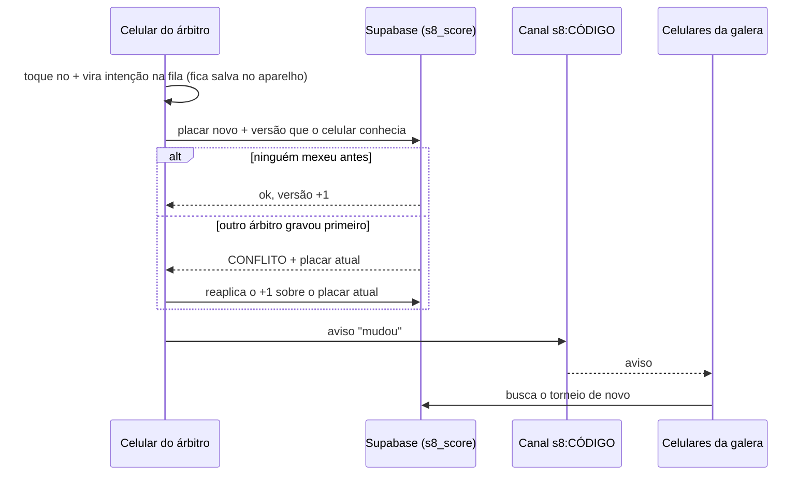

# Super 8 ao vivo 🎾

Sorteio, placar e ranking de torneios de beach tennis, atualizando ao vivo no celular de todo mundo.
Quem organiza cria o torneio e recebe um **código** (tipo `VD22NV`). Quem tem o código acompanha;
quem tem o **PIN de árbitro** lança placar. Sem login e sem instalar nada.

**No ar:** https://by-bc.github.io/super8-ao-vivo/

## O que dá para configurar

| Grupo | Opções |
|---|---|
| Modalidade | **Mista** (H+M) · **Mesmo gênero** (masculino x masculino, feminino x feminino, ranking separado) · **Livre** |
| Formato | **Rodízio / Super 8** (parceiro novo a cada rodada, ranking individual) · **Duplas fixas** todos contra todos · **Grupos + mata-mata** · **Mexicano** (cada rodada montada pelo ranking: 1º e 4º contra 2º e 3º) |
| Formação das duplas | Sorteio · Equilibrado por nível (forte com mais fraco) · Manual |
| Partida | Total fixo de games, com empate (ex.: 4 → 3x1 acaba, 2x2 empata) · Primeiro a X games · Set de 4 ou 6 com tie-break · Melhor de 3 com match tie-break de 10 |
| Ranking | Games feitos · Vitória 3, empate 1, derrota 0 · Média por partida · Rei e Rainha da areia · ordem de desempate escolhida (vitórias, saldo, confronto direto, games) |
| Logística | Número de quadras, número de rodadas (com sugestão), grupos e classificados por grupo |

Também tem: **colar a lista do WhatsApp** (entende "👩 Mulheres / 👨 Homens", numeração e "Bruno homem"),
mensagem pronta do ranking e da tabela para o grupo, link com QR code e **modo telão** para TV na beira da quadra.

Dentro do game a contagem segue a regra (15, 30, 40 e ponto decisivo no 40 a 40). O app conta só os games.

## Como o placar fica certo com vários celulares



- **Sem ponto perdido:** a gravação usa trava de versão. Dois árbitros apertando + juntos dão +2, não +1.
- **Sem internet na quadra:** o toque aparece na hora e fica numa fila no aparelho. Quando a conexão volta, a fila sobe sozinha.
- **Aviso falso não engana:** o canal de tempo real é público, então ele só avisa que algo mudou; quem recebe sempre lê o placar no banco.
- **Se o tempo real cair**, a tela consulta o servidor a cada 15 segundos e quando o celular volta para o app.

## Segurança

- As tabelas ficam no schema `super8`, que **não é exposto** pela API. O app só chama as funções `public.s8_*`
  (`security definer`, `search_path` vazio), que validam a entrada e conferem permissão antes de qualquer escrita.
- **PIN** guardado com bcrypt (custo 12). Na 8ª tentativa errada em 15 minutos o torneio bloqueia novas entradas por 15 minutos.
- Quem acerta o PIN recebe um token aleatório de 192 bits que vale 3 dias; o banco guarda só o SHA-256 dele.
- **Chave do organizador** (192 bits) fica só no aparelho de quem criou; é ela que permite editar nomes, trocar o PIN e sortear de novo.
  Trocar o PIN derruba na hora todo mundo que entrou com o PIN antigo.
- Freio contra criação em massa: no máximo 30 torneios por minuto no servidor todo.

O que **não** está coberto: quem tem o PIN pode lançar placar errado de propósito (o PIN é para gente de confiança), e o código de 6 letras
deixa o torneio visível para quem souber ou adivinhar o código.

## Rodando localmente

```bash
npm install
cp .env.example .env.local   # preencha com a URL e a chave anon do seu projeto Supabase
npm run dev                  # http://localhost:5173/super8-ao-vivo/
npm test                     # motor do torneio: formatos, pontuação, ranking, importação da lista
```

### Banco

Aplique `supabase/migrations/20261107180000_super8.sql` no seu projeto (SQL Editor ou `supabase db push`).
Ela cria o schema `super8`, as tabelas e as funções `s8_*`. Nada fora do schema `super8` é alterado, além das funções `public.s8_*`.

### Publicação

O workflow `.github/workflows/deploy.yml` roda os testes, gera o build e publica no GitHub Pages a cada push na `main`.
Ele lê duas variáveis do repositório (Settings → Secrets and variables → Actions → Variables):
`VITE_SUPABASE_URL` e `VITE_SUPABASE_ANON_KEY`.

## Estrutura

```
src/engine/       motor puro, sem React e sem rede (testado com Vitest)
  schedule.ts     rodízio (quadrado latino, método do círculo e busca local), duplas, grupos, quadras
  mexicano.ts     rodadas montadas pelo ranking
  knockout.ts     chave do mata-mata com folga, cabeças de chave e cruzamento de grupos
  scoring.ts      tipos de partida, game de desempate no mata-mata
  standings.ts    ranking e desempates
  importer.ts     leitura da lista colada do WhatsApp
  whatsapp.ts     mensagens prontas para o grupo
src/lib/          Supabase, chamadas RPC, fila offline e tempo real (useTournament)
src/pages/        Início, Novo torneio, Torneio, Telão
supabase/         migration do banco
```

## Próximos passos

- Inscrição pelo próprio link (a galera coloca o nome antes do sorteio)
- Disputa de 3º lugar no mata-mata
- Histórico de jogadores entre torneios (ranking da temporada)
- Limpeza automática de torneios antigos

## Licença

MIT
