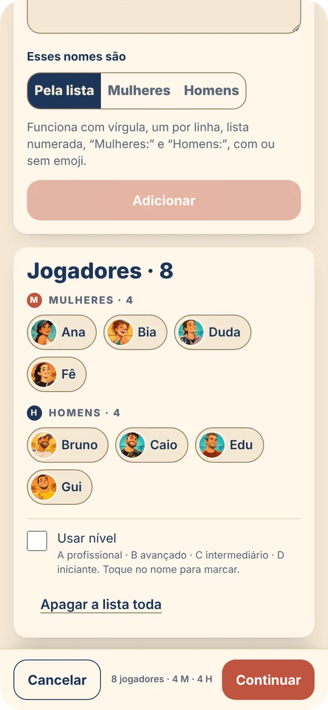
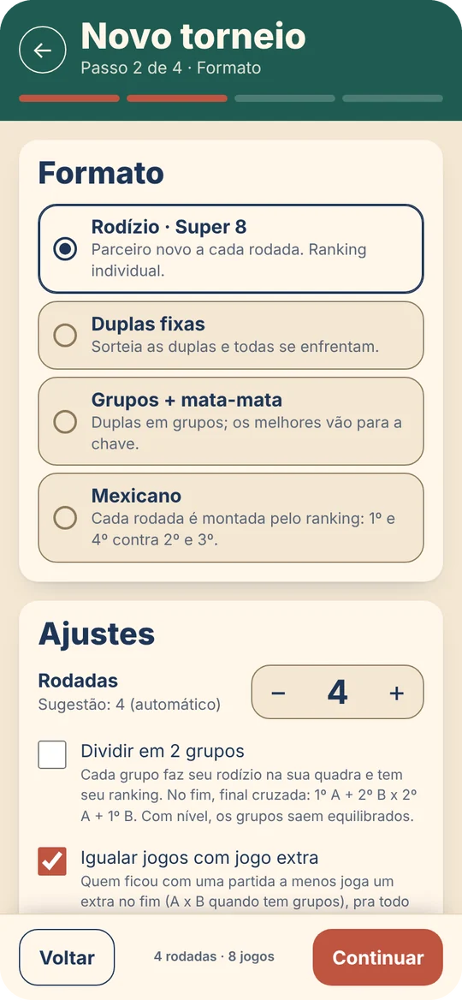
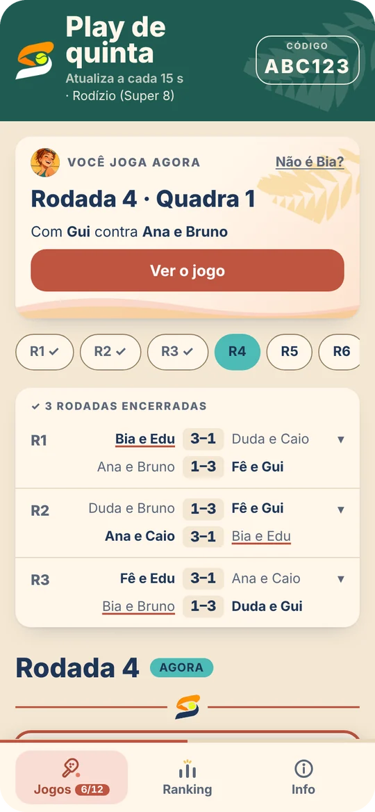
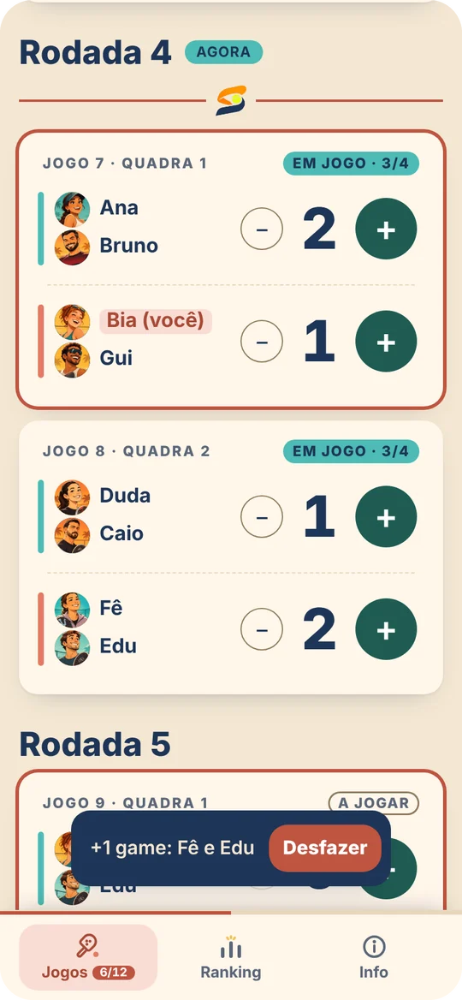
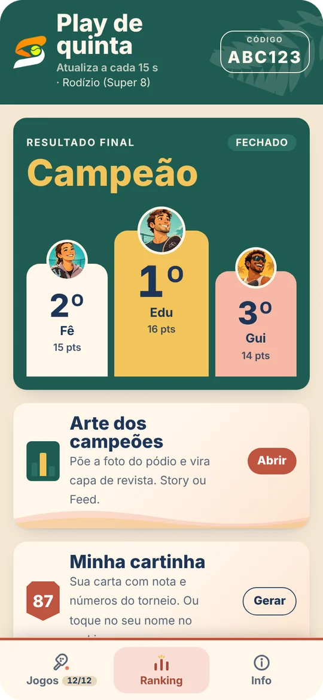
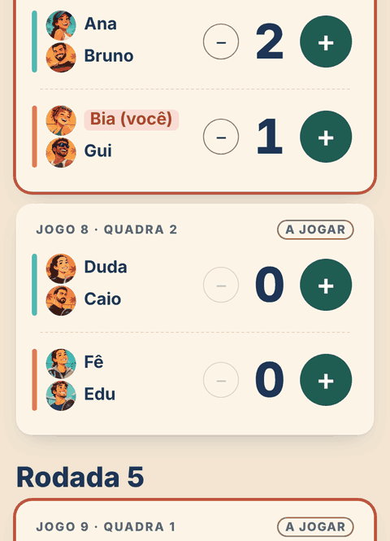
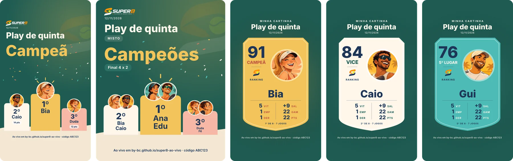
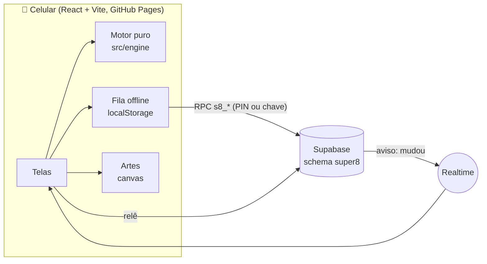
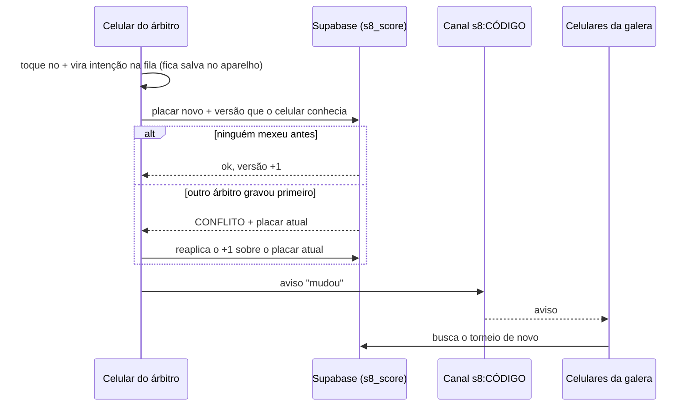
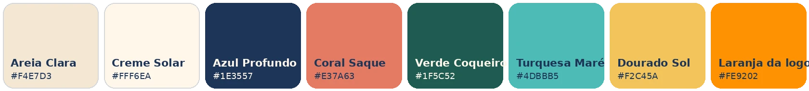

<p align="center">
  
</p>

<p align="center">
  <b>Sorteio, placar e ranking do play de beach tennis, ao vivo no celular de todo mundo.</b><br>
  Sem cadastro, sem senha, sem app pra instalar: um código no grupo do WhatsApp e a quadra inteira acompanha.
</p>

<p align="center">
  <a href="https://by-bc.github.io/super8-ao-vivo/"><b>▶ Abrir o app</b></a> ·
  <a href="#um-play-em-cinco-telas">Como funciona</a> ·
  <a href="#por-dentro">Por dentro</a> ·
  <a href="#rodando-localmente">Rodar local</a>
</p>

<p align="center">
  <a href="https://github.com/by-BC/super8-ao-vivo/actions/workflows/deploy.yml"></a>
  
  
  
  
  
</p>

---

## A regra de ouro

> **Nada pode atrapalhar o jogo.**

Num play com rodízio alguém sorteia as duplas, alguém anota o placar de cada quadra e, no fim, alguém faz a conta do ranking
no papel. O Super 8 tira esse trabalho de uma pessoa só e põe no celular que todo mundo já tem na mão.
Cada decisão do projeto passa por essa regra: se exige login, atrasa a quadra ou some com um ponto quando a internet cai, não entra.

| Quem | Tem o quê | Pode o quê |
|---|---|---|
| 🏟️ **Galera** | o código de 6 letras (ex.: `VD22NV`) | acompanhar jogos, ranking e pódio ao vivo |
| 🎾 **Árbitro** | o PIN | lançar e corrigir placar |
| 📋 **Organizador** | a chave guardada no celular de quem criou | editar o torneio inteiro, trocar o PIN, sortear de novo |

---

## Um play em cinco telas

<table>
  <tr>
    <td align="center" width="20%"></td>
    <td align="center" width="20%"></td>
    <td align="center" width="20%"></td>
    <td align="center" width="20%"></td>
    <td align="center" width="20%"></td>
  </tr>
  <tr>
    <td valign="top"><b>1. Cola a lista</b><br><sub>Do jeito que veio do WhatsApp: com vírgula, numerada, com emoji, "Mulheres:" e "Homens:". Cada um ganha um personagem.</sub></td>
    <td valign="top"><b>2. Escolhe o formato</b><br><sub>Rodízio, duplas fixas, grupos + mata-mata ou mexicano. O app sugere rodadas e mostra quantos jogos cada um faz.</sub></td>
    <td valign="top"><b>3. Cada um se acha</b><br><sub>"Sou eu" mostra o próximo jogo, a quadra, o parceiro e os adversários. A tela abre na rodada que está rolando.</sub></td>
    <td valign="top"><b>4. Placar no dedo</b><br><sub>Um toque por game, com desfazer. A tela não apaga pro árbitro e o ponto não se perde sem internet.</sub></td>
    <td valign="top"><b>5. Pódio e story</b><br><sub>Ranking ao vivo, pódio no fim e arte pronta pro story: dos campeões, com foto, e a cartinha de cada um.</sub></td>
  </tr>
</table>

---

## O ponto não se perde



Quadra de areia tem sol na tela, mão suada e 4G fraco. Por isso o placar foi o ponto mais cuidado do app:

- **Desfazer** — cada game lançado mostra "+1 game: Fê e Edu · Desfazer" por alguns segundos.
- **Sem internet** — o toque aparece na hora e fica numa fila no aparelho; quando a conexão volta, sobe sozinho.
- **Dois árbitros, nenhum ponto perdido** — cada partida tem trava de versão: dois + ao mesmo tempo dão +2, não +1.
- **Tela acesa** — pro árbitro e no modo telão a tela não bloqueia no meio do jogo.
- **Corrigir depois do fim** — quem tem o PIN toca em *Corrigir*; ranking e pódio se recalculam sozinhos.
- **Ao vivo de verdade** — canal em tempo real; se ele cair, a tela consulta o servidor a cada 15 segundos.

<br clear="right">

---

## Feito pra virar story

<p align="center">
  
</p>

Quando o torneio acaba, o app monta as artes **no próprio celular** (canvas, a foto nunca sai do aparelho):
o pódio em story ou post com confete e o personagem de cada um, o pôster com a foto do grupo se dissolvendo num fundo feito dela mesma,
e a **cartinha colecionável** de cada jogador, com nota e números do torneio, em três raridades: dourada pro campeão, creme pro vice e turquesa pro resto.

<p align="center">
  
</p>

**21 personagens** (10 mulheres e 11 homens) fazem as vezes de foto de perfil, sem guardar foto de ninguém.
Cada jogador recebe um do próprio gênero, sem repetir em sequência; o organizador pode escolher outro.

---

## Do jeito do seu play

| | |
|---|---|
| **Tipo** | Misto · Feminino e masculino (cada um com sua chave e seu ranking, no mesmo código) · Só feminino · Só masculino · Livre |
| **Formato** | **Rodízio / Super 8** (parceiro novo a cada rodada) · **Duplas fixas** todos contra todos · **Grupos + mata-mata** · **Mexicano** (1º e 4º contra 2º e 3º) |
| **Duplas** | Sorteio · Equilibrado por nível A–D (forte com mais fraco) · Manual |
| **Partida** | Total de games, com empate · Primeiro a X · Set de 4 ou 6 com tie-break · Melhor de 3 com match tie-break de 10 |
| **Ranking** | Games feitos · Vitória 3, empate 1 · Média por partida · Rei e Rainha da areia · ordem de desempate escolhida |
| **Quadra** | Quadras, rodadas sugeridas, grupos, classificados, rodízio em 2 grupos com final cruzada, jogo extra pra igualar partidas |
| **Entrada** | Lista colada · Inscrição pelo link com nível, vagas e lista de espera · Formato decidido depois, com sugestões pela lista |
| **Telão** | Modo TV pra beira da quadra, com a rodada atual e o ranking, ao vivo |

### O organizador muda o que quiser, sem perder placar

Depois de criado, dá pra mexer em jogadores, gênero, nível, formato, partida, ranking, quadras, rodadas, grupos e duplas.
Antes de salvar, o app mostra o que fica:

| Mudou… | Acontece |
|---|---|
| nome, partida, games, ranking, desempate, nível, nome de jogador | **A tabela não muda.** Todos os placares ficam. |
| rodízio/mexicano: entrou ou saiu gente, mais rodadas, mais quadras | **Ficam as rodadas jogadas**; só daí pra frente é sorteado de novo. Quem saiu mantém os jogos que fez. |
| formato, tipo, grupos, duplas fixas | Refaz a tabela inteira e avisa antes quantos placares somem. |

---

## Por dentro



<details>
<summary><b>Como o placar fica certo com vários celulares</b></summary>



O canal de tempo real é público, então ele só avisa *que* algo mudou; quem recebe sempre lê o placar no banco. Aviso falso não engana ninguém.
</details>

<details>
<summary><b>Decisões de stack</b></summary>

| Peça | Escolha | Por quê |
|---|---|---|
| Front | React 18 + TypeScript + Vite + Tailwind | Leve, sem servidor próprio; publicado no GitHub Pages |
| Motor | TypeScript puro em `src/engine` | Sorteio, pontuação, ranking e edição sem React nem rede: dá pra testar tudo com Vitest |
| Banco | Supabase (Postgres) com funções `security definer` | Sem login: PIN e chave do organizador são conferidos dentro do banco |
| Tempo real | Canal Realtime só com aviso de "mudou" | Quem recebe relê do banco |
| Concorrência | Trava otimista por versão em cada partida | Dois árbitros juntos não perdem ponto |
| Edição | `planEdit` puro + `s8_admin_edit` | O app decide o que manter; o banco recusa se alguém lançou placar no meio |
| Artes | Canvas no celular | A foto nunca sai do aparelho |
</details>

<details>
<summary><b>Segurança</b></summary>

- As tabelas ficam no schema `super8`, que **não é exposto** pela API. O app só chama funções `public.s8_*`
  (`security definer`, `search_path` vazio), que validam a entrada e conferem permissão antes de qualquer escrita.
- **PIN** com bcrypt (custo 12). Na 8ª tentativa errada em 15 minutos, o torneio bloqueia novas entradas por 15 minutos.
- Quem acerta o PIN recebe um token aleatório de 192 bits que vale 3 dias; o banco guarda só o SHA-256 dele.
- **Chave do organizador** (192 bits) fica só no aparelho de quem criou. Trocar o PIN derruba na hora quem entrou com o antigo.
- Freio contra criação em massa: no máximo 30 torneios por minuto no servidor todo.
- **Limpeza automática** às 3h (Brasília): sai o torneio jogado e parado há 6 horas, e qualquer um esquecido há 30 dias.

O que **não** está coberto: quem tem o PIN pode lançar placar errado de propósito (o PIN é pra gente de confiança),
e o código de 6 letras deixa o torneio visível pra quem souber ou adivinhar.
</details>

<details>
<summary><b>Estrutura do código</b></summary>

```
src/engine/       motor puro, sem React e sem rede (Vitest)
  schedule.ts     rodízio (quadrado latino, método do círculo e busca local), duplas, grupos, quadras
  mexicano.ts     rodadas montadas pelo ranking
  knockout.ts     mata-mata com folga, cabeças de chave e cruzamento de grupos
  scoring.ts      tipos de partida e game de desempate
  standings.ts    ranking e desempates
  edit.ts         o que fica e o que é sorteado de novo quando o organizador edita
  importer.ts     leitura da lista colada do WhatsApp
  whatsapp.ts     mensagens prontas pro grupo
src/lib/          Supabase, RPC, fila offline, tempo real, tela acesa, personagens, artes em canvas
src/components/   placar, ranking, pódio, marca, ícones, enfeites de praia
src/pages/        Início, Novo torneio (e edição), Torneio, Telão, Inscrição
supabase/         migrations do banco
public/marca      logo oficial · public/avatares  os 21 personagens
```
</details>

---

## Identidade

<p align="center">
  
</p>

**Clube de sol:** o beach tennis como clube social, divertido e ensolarado.
A **logo oficial** é o S em duas faixas, laranja e branca, segurando a bola. Títulos em **Outfit**, interface em **DM Sans**.
Cartões creme com cantos macios, ícones próprios, folha de coqueiro e onda de areia como enfeite, sempre longe do placar.
Tema Noite automático quando o celular está no modo escuro.

---

## Rodando localmente

```bash
npm install
cp .env.example .env.local   # URL e chave anon do seu projeto Supabase
npm run dev                  # http://localhost:5173/super8-ao-vivo/
npm test                     # motor e personagens: 51 testes
```

**Banco:** aplique as migrations de `supabase/migrations/` na ordem (SQL Editor ou `supabase db push`).
Elas criam o schema `super8`, as tabelas e as funções `public.s8_*`; nada fora disso é alterado.

**Publicação:** cada push na `main` roda os testes, gera o build e publica na branch `gh-pages`.
A URL e a chave anon ficam em `.env.production`: são públicas de qualquer jeito; quem protege o banco são as funções `s8_*` e o RLS fechado.

---

## Próximas jogadas

- [ ] **Liga da quinta:** somar os plays da semana num ranking da temporada
- [ ] Levar a chave do organizador pra outro celular sem copiar à mão
- [ ] Cada jogador escolher o próprio personagem
- [ ] Testes de tela (criar, lançar ponto, desfazer, encerrar) no CI
- [ ] Disputa de 3º lugar no mata-mata

---

<p align="center">
  Feito por <a href="https://github.com/by-BC">Bruno Candido</a> · <a href="https://www.linkedin.com/in/brnocandido">LinkedIn</a><br>
  <sub>Licença MIT</sub>
</p>
